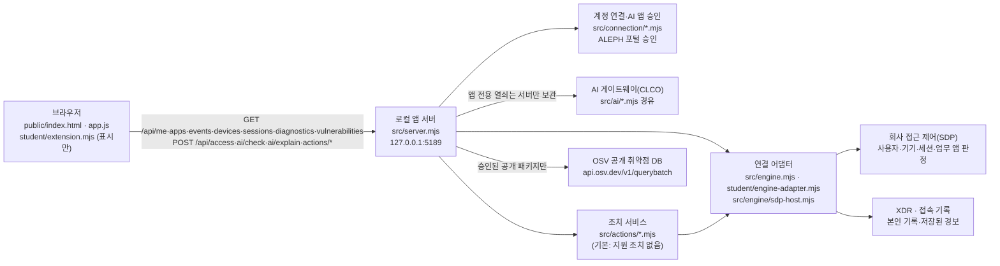

# 케셰브 실행 설명서와 구성도 (학생 작성)

이 문서는 학생이 작성한 실행 설명서입니다. 다른 사람이 이 프로젝트를 받아 실행하고, 구조를 이해하고, 오류가 났을 때 확인할 순서를 찾을 수 있도록 정리했습니다. 제공 문서(`README.md`, `docs/STUDENT_LAUNCH_GUIDE.md`, `docs/CONNECTION_TROUBLESHOOT.md` 등)는 고치지 않았고, 이 문서는 그 내용을 실제 코드와 대조해 학생 관점으로 다시 묶은 것입니다.

표기 규칙: **확인함**은 실제로 실행하거나 화면·응답을 본 것, **모의 확인**은 가짜 입력으로 학생 함수만 그려 본 것, **미확인**은 실행하지 않았거나 운영 측 준비가 필요해 확인하지 못한 것입니다. 미확인 항목을 확인했다고 적지 않습니다.

## 1. 목적과 기능

케셰브는 직원이 자기 로그인·기기·세션 상태, 업무 앱 접속 판정, 본인 접속 기록과 XDR 경보, AI 사건 설명, 조치 처리 상태, 설치 패키지의 알려진 취약점을 한 화면에서 보는 보안 앱입니다. 브라우저 화면은 PC 안의 로컬 앱 서버(`127.0.0.1`)에만 요청하고, 로컬 앱 서버가 회사 시스템(SDP 접근 제어·XDR), AI 게이트웨이, OSV 를 대신 호출합니다.

| 화면(메뉴) | 기능 | 학생 함수(`student/extension.mjs`) | 단계 |
|---|---|---|---|
| 보호 현황 | 로그인 사용자·현재 기기·세션 | `renderIdentity` | 13 |
| 업무 앱 | 선택한 업무 앱의 접근 판정(allow·deny·challenge·unknown)과 이유·시각 | `renderDecision` | 14 |
| 보안 기록 | 본인 접속 기록·저장된 XDR 경보 최신순 목록·필터·상세 | `renderEvents` | 15 |
| 보호 현황 | 알림·등록 기기·현재 세션·도움정보 복사, 미지원 조치 안내 | `renderStatus` (+ `renderEvents` 상세) | 16 |
| 보호 현황 · AI 연결 | AI 연결 점검(test/verified·모델 수·시각)과 원인별 오류 | `renderAiConnection` | 17 |
| 보안 기록 · AI 설명 | 선택 사건의 근거·규칙·확인 불가 상태와 연결된 AI 설명 | `renderExplanation` | 17·18 |
| 보안 기록 · 조치 | 제안·사람 확인·서버 접수(ACK)·효과 관측·결과 불명 구분 | `renderAction` | 19 |
| 보호 현황 · 설치 패키지 | package-lock 의 정확한 설치 버전과 OSV 조회 결과 | `renderVulnerabilities` | 20 |

## 2. 지원 환경과 버전

| 항목 | 값 | 근거·상태 |
|---|---|---|
| 운영체제 | Windows + PowerShell (실행 도구 `tools/start-alekov.ps1`) | 제공 실행 도구 기준 |
| Node.js | 수업 기준 24.19.0 (`package.json` 의 `engines.node`), 실행 도구는 22~24 허용 | `package.json`, `docs/STUDENT_LAUNCH_GUIDE.md` |
| 실제로 확인한 Node.js | v22.23.4 (사용자 PC 의 Linux 작업 환경) | **확인함**: 이 버전으로 `node --check` 와 서버 실행을 확인했습니다. Windows 의 Node.js 버전은 **미확인**입니다. 새 PowerShell 창에서 `node --version` 으로 확인하세요. |
| npm 의존성 | 없음 (`on-client/package.json` 에 dependencies 없음) | `package.json` |
| 시작 틀 버전 | 0.2.11 (`package.json` 의 `version`) | 서버 응답의 `meta.starterVersion` 은 0.1.0 으로 나옵니다(제공 서버 값, 고치지 않음) |
| 브라우저 | PC 브라우저에서 `http://127.0.0.1:5189/` | 서버가 `127.0.0.1` 에만 열림(`src/server.mjs`) |
| 지원하지 않음 | 다른 PC·휴대폰에서 접속, 외부 공개 배포, 주소·열쇠 직접 입력 | 서버가 `127.0.0.1`·`localhost` 호스트만 허용 |

## 3. 폴더 구조

Git 저장소 최상위는 프로젝트 폴더이고, 앱 폴더는 그 안의 `on-client` 입니다.

```
choi-bujang-secret-vault/          ← Git 최상위(커밋·push·제출 기준)
└─ on-client/                      ← 앱 폴더(여기서 PowerShell 을 열고 실행)
   ├─ package.json                 실행 스크립트 start·demo·check, Node 24.19.0
   ├─ .env.example                 비밀 없는 설정 예시(실제 .env 는 커밋하지 않음)
   ├─ tools/start-alekov.ps1       제공 실행 도구(Node 버전·포트 확인 후 서버 실행)
   ├─ src/server.mjs               제공 로컬 앱 서버(HTTP·API 라우팅·정적 파일)
   ├─ src/engine.mjs               회사 시스템 연결 어댑터 로딩·예제(demo) 엔진
   ├─ src/engine/sdp-host*.mjs     SDP 접근 제어 호스트 연결(담당자 설정 시)
   ├─ src/connection/*.mjs         계정 연결(native login)·AI 앱 승인 관리
   ├─ src/ai/*.mjs                 AI 게이트웨이 호출·앱 권한 확인·열쇠 보관
   ├─ src/actions/*.mjs            조치 준비·집행·결과 조회(기본은 지원 조치 없음)
   ├─ src/vulnerabilities/*.mjs    package-lock 읽기·OSV 조회
   ├─ public/index.html, app.js    제공 화면·버튼·요청(학생 함수 호출부)
   ├─ public/vulnerabilities-view.mjs  OSV 응답 형식 검사·제공 표시
   ├─ student/extension.mjs        학생 작성 표시 함수(13~20단계)
   ├─ student/engine-adapter.mjs   기존 서버 연결 어댑터 자리(기본 disconnected)
   └─ docs/                        제공 안내 문서 + 이 문서(STUDENT_RUNBOOK.md)
```

## 4. 실행·종료·재실행

### 4.1 PowerShell 여는 위치

1. 파일 탐색기에서 `C:\Users\<내 계정>\work\choi-bujang-secret-vault\on-client` 처럼 **앱 폴더(`on-client`)** 를 엽니다. 프로젝트 최상위가 아니라 `on-client` 입니다.
2. 주소 표시줄에 `powershell` 을 입력하고 Enter 를 누릅니다.
3. 먼저 버전을 확인합니다: `node --version` (22~24, 수업 기준 v24.19.0).

### 4.2 실행 명령

| 목적 | 명령(앱 폴더에서) | 정상 시작 신호 |
|---|---|---|
| 기본 실행(권장) | `powershell -NoProfile -ExecutionPolicy Bypass -File .\tools\start-alekov.ps1` | `케셰브가 켜졌습니다. 브라우저에서 http://127.0.0.1:5189/ 을 여세요.` 와 `서버가 응답한 것만 확인했습니다. AI 연결 상태는 화면에서 따로 확인해 주세요.` |
| 실행 도구 없이 | `npm start` (= `node src/server.mjs`) | `케셰브 연결 확인: http://127.0.0.1:5189` |
| 예제 자료 화면 | `npm run demo` (= `node src/server.mjs --demo`) | `케셰브 예제: http://127.0.0.1:5189` — 예제(demo)는 실제 연결·성취가 아님 |
| 학생 코드 문법 확인 | `npm run check` (= `node --check student/extension.mjs`) | 아무 출력 없이 끝나면 정상 |
| 포트 변경 | 실행 도구 뒤에 ` -Port 5190`, 또는 환경변수 `ON_PORT` | 브라우저 주소도 `:5190` 으로 엽니다 |

서버는 `.env` 파일을 자동으로 읽지 않고 프로세스 환경변수만 읽습니다. `on-client/.env.example` 은 쓸 수 있는 이름과 비밀 없는 예시 값을 보여 주는 견본이며, 필요하면 같은 PowerShell 창에서 `$env:ON_PORT = "5190"` 처럼 지정한 뒤 `npm start` 를 실행합니다.

Node 22 에서는 `ExperimentalWarning: SQLite is an experimental feature` 경고가 한 번 보일 수 있습니다. 조치 기록 저장(`src/actions/store.mjs`)이 Node 내장 SQLite 를 쓰기 때문이며 실행 실패가 아닙니다(**확인함**, Node v22.23.4).

### 4.3 브라우저에서 확인

`http://127.0.0.1:5189/` 를 열면 위쪽에 「다시 불러오기」, 왼쪽에 「보호 현황」「업무 앱」「보안 기록」 메뉴가 보입니다. 기본 실행은 회사 시스템에 연결되지 않은 상태라 로그인·기록 칸에 `ENGINE_NOT_CONNECTED`(연결 실패) 가 보이는 것이 정상이며, 설치 패키지 조회는 `not_configured`(조회 준비 미완료)로 나옵니다.

### 4.4 종료와 재실행

- 종료: 서버를 실행한 PowerShell 창에서 `Ctrl+C`. 브라우저 주소가 더 이상 열리지 않으면 종료된 것입니다. `-Background` 로 실행했다면 안내된 프로세스 번호의 node 를 작업 관리자에서 종료합니다.
- 재실행: 같은 앱 폴더에서 4.2 의 명령을 다시 실행합니다. 실행·종료는 학생 파일을 바꾸지 않습니다.
- 학생 코드를 고친 뒤에는 서버를 다시 켜지 않아도 브라우저 새로고침(F5)으로 `student/extension.mjs` 를 다시 읽습니다. 화면 안의 「다시 불러오기」는 자료(API)만 다시 요청합니다.

## 5. 구성도

### 5.1 Mermaid



### 5.2 같은 내용의 글 설명

| 출발 | 도착 | 무엇을 | 비고 |
|---|---|---|---|
| 브라우저 | 로컬 앱 서버 | `GET /api/me`, `/api/apps`, `/api/events`, `/api/devices`, `/api/sessions`, `/api/diagnostics`, `/api/vulnerabilities` | 학생 코드(`api.get`)는 이 중 diagnostics 를 뺀 여섯 개만 읽을 수 있음 |
| 브라우저 | 로컬 앱 서버 | `POST /api/access`, `/api/ai/check`, `/api/ai/explain`, `/api/actions/prepare`·`execute`·`result`, `/api/native-login/...` | 제공 버튼만 보냄. 학생 코드에는 POST 함수가 없음 |
| 로컬 앱 서버 | 연결 어댑터 → SDP 접근 제어 | 로그인 사용자·기기·세션, 업무 앱 목록, 접근 판정 | 기본은 연결 없음(`ENGINE_NOT_CONNECTED`). 담당자가 `-SdpHostConfig` 를 안내한 경우에만 연결 |
| 로컬 앱 서버 | 연결 어댑터 → XDR·접속 기록 | 본인의 최근 기록(최대 40건)과 저장된 XDR 경보 | 전체 직원 이력이 아님 |
| 로컬 앱 서버 | AI 게이트웨이(CLCO) | 모델 목록 점검(`/api/ai/check`), 선택 사건 설명(`/api/ai/explain`) | 계정 연결과 AI 앱 승인이 끝나야 함. 열쇠는 화면·학생 코드·Git 에 없음 |
| 로컬 앱 서버 | 조치 서비스 → 연결 어댑터 | 사람 확인 후 조치 전달, 연동 시스템 결과 재조회 | 지금 기록의 `supportedActions` 는 비어 있어 실제 경로가 열리지 않음 |
| 로컬 앱 서버 | OSV | `package-lock.json` 의 정확한 설치 버전 | 승인 목록(`ON_APPROVED_PUBLIC_PACKAGES`)이 비면 외부 조회하지 않음 |

공개 가능한 주소만 적었습니다: 로컬 `http://127.0.0.1:5189`, 포털 `https://aleph-omega.vercel.app`, OSV `https://api.osv.dev/v1/querybatch`. 설정값·열쇠·토큰은 이 문서에 쓰지 않습니다(`.env.example` 에는 이름만 있고, 실제 `.env` 는 커밋하지 않음).

## 6. 제공 코드와 학생 작성 부분의 경계

| 구분 | 파일 | 학생이 고쳤나 |
|---|---|---|
| 학생 작성 | `on-client/student/extension.mjs` (`renderIdentity`·`renderDecision`·`renderEvents`·`renderStatus`·`renderAiConnection`·`renderExplanation`·`renderAction`·`renderVulnerabilities`) | 예 (13~20단계) |
| 학생 작성 | `on-client/docs/STUDENT_RUNBOOK.md`(이 문서), `on-client/README.md` 의 「학생 작성 부분」 | 예 (21단계) |
| 제공(고치지 않음) | `src/**`, `public/**`, `tools/**`, `student/engine-adapter.mjs`, 그 밖의 `docs/**` | 아니요 |

학생 함수의 공통 규칙: 화면 요소는 `document.createElement` 와 `textContent` 로만 만들고 `innerHTML` 을 쓰지 않습니다. 함수는 받은 입력만으로 매번 새로 그려, 다시 불러오기·다른 기록 선택·취소 뒤에 이전 결과가 남지 않습니다. 자동으로 다시 요청하지 않고, 다시 시도는 사용자가 버튼을 직접 누르도록 안내합니다.

| 함수 | 입력 | 구분해 보여 주는 것 |
|---|---|---|
| `renderIdentity` | `{ me, devices, sessions }` | 불러오는 중·실패·확인 불가, 주의가 필요한 기기·세션 상태 |
| `renderDecision` | `{ status, mode, data, error, appId }` | 허용·거부·추가 확인·판정 확인 불가, 요청 실패는 거부와 다름 |
| `renderEvents` | `{ status, mode, data, error }` | 최신순 목록, 종류·앱·접속 상태 필터, 상세(근거·규칙·세 상태), 빈 목록과 조회 실패 구분 |
| `renderStatus` | `{ devices, sessions, notifications, diagnostics, mode }` | 알림, 빈 목록·실패·시간 초과, 「도움정보 복사」(비밀 가림) |
| `renderAiConnection` | `{ status, mode, data, error, checkedAt, explanationAccepted }` | 점검 전·중·결과(test/verified·모델 수·시각), 원인별 오류, 사건 설명 미실행 |
| `renderExplanation` | `{ event, explanation, checkedAt }` | 실패 우선, 근거 ID 대조·규칙·확인 불가 상태·제안 미실행, 근거 불일치 거부 |
| `renderAction` | `{ status, event, actionId, target, receipt, observation, message, confirmationExpiresAt, error }` | 11개 상태, ACK 와 효과 관측 분리, 현재 사건·조치 대조, 재전달 안내 |
| `renderVulnerabilities` | `{ status, mode, data, error }` | 조회 전·중·실패, 전체 상태 5가지, 정확한 설치 버전, 일부 조회 시 받은 ID 유지 |

## 7. 확인 결과와 미확인 항목

| 항목 | 상태 | 어떻게 |
|---|---|---|
| 학생 코드 문법 | 확인함 | `node --check student/extension.mjs` (Node v22.23.4) |
| 서버 실행·정적 파일 | 확인함 | `node src/server.mjs --demo` 실행 후 `/`, `/student/extension.mjs`, 여섯 개 GET API 가 200 응답 |
| 기본 실행(연결 없음) 응답 | 확인함 | `/api/me`·`/api/events` = `ENGINE_NOT_CONNECTED`, `/api/vulnerabilities` = `not_configured`, `/api/ai/check` = `ENGINE_NOT_CONNECTED` |
| 학생 함수 상태별 표시(13~20) | 모의 확인 | 가짜 DOM 에 상태별 입력을 넣어 문장·data 속성을 확인 |
| ALEPH 공식 판정 17~20단계 | 확인함 | 상황실 화면에서 각 단계 필수 항목 모두 통과 표시 |
| Windows PowerShell 실행 도구(`start-alekov.ps1`) 실행 | 미확인 | 이 문서 작성 중 Windows 창에서 직접 실행하지 않음 |
| Windows 의 Node.js 버전 | 미확인 | 새 PowerShell 창에서 `node --version` 으로 확인 필요 |
| 실제 SDP·XDR 연결(사용자·기기·판정·기록) | 미확인 | 담당자의 개인 SDP 설정이 필요 |
| 실제 AI 연결 점검·AI 사건 설명 | 미확인 | 운영 측 계정·앱 권한 준비 필요, 유료 요청을 시험 삼아 보내지 않음 |
| 실제 조치 집행·결과 관측 | 미확인 | 지원 조치가 없음(`supportedActions` 빈 배열), 집행을 시험 삼아 요청하지 않음 |
| 실제 OSV 조회 결과 | 미확인 | 승인 패키지 목록이 비어 `not_configured` |

## 8. 오류별 확인 순서

오류가 나면 위에서부터 한 단계씩 확인합니다. 파일을 지우거나 열쇠를 복사해 붙이지 않습니다. 자세한 코드 목록은 `docs/CONNECTION_TROUBLESHOOT.md` 에 있습니다.

| 증상(화면·창 메시지) | 원인 | 확인·복구 |
|---|---|---|
| `Node.js 가 없습니다` / `지금 Node.js 는 vXX 입니다` | Node 미설치·버전 범위 밖 | Node 24.19.0 설치 → 새 PowerShell 창 → 다시 실행 |
| `포트 5189 를 다른 프로그램이 쓰고 있습니다` | 포트 충돌 | 그 프로그램은 두고 ` -Port 5190` 으로 실행, 브라우저도 `:5190` |
| `앱 폴더가 아닙니다` | 잘못된 위치에서 실행 | `on-client` 폴더에서 PowerShell 을 다시 엶 |
| 브라우저가 열리지 않음 | 서버가 꺼짐 | PowerShell 창에 시작 신호가 있는지 확인 → 없으면 다시 실행 |
| 학생 칸에 `학생 구현 ... 실행 중 오류` | `student/extension.mjs` 예외 | `npm run check` → 마지막 커밋과 `git diff` 비교 |
| 로그인·기록 칸 `ENGINE_NOT_CONNECTED` | 회사 시스템 미연결(기본 상태) | 정상. 실제 연결은 담당자가 안내한 `-SdpHostConfig` 로만 |
| 「예제 자료(demo)」 표시 | `npm run demo` 로 실행 | 실제 연결이 아님. 기본 실행으로 다시 켬 |
| AI 연결 칸 `ON_AI_PROVISIONING_PENDING` 등 권한 준비 중 | 운영 측 계정·앱 권한 미준비 | 학생 잘못 아님. 담당자에게 계정 연결·앱 권한 확인 요청 |
| AI `WB_CLCO_AUTH_REQUIRED`·`ACCESS_BLOCKED` | 인증·접근 제한 | 「계정 연결 시작」→「AI 연결 시작」을 다시 진행, 계속되면 담당자 |
| AI `..._BUDGET_EXHAUSTED`·`LIMIT_REACHED`·`SESSION_CLOSED` | 한도·이용 시간 | 담당자·이용 시간 확인 |
| AI `..._TIMEOUT`·`RATE_LIMITED`·`CANCELLED` | 시간 초과·요청 제한·취소 | 잠시 뒤 「현재 API 연결 점검」을 직접 다시 누름 |
| AI 설명 `ON_AI_INVALID_OUTPUT` | 근거 불일치·실행 주장 등 | 설명을 쓰지 않음. 기록은 그대로 사용 |
| 조치 `unknown`(결과 불명) | 전달 뒤 결과 확인 불가 | 「원천 결과만 재조회」만 누름. 같은 조치를 다시 집행하지 않음 |
| 설치 패키지 `not_configured`·`not_checked` | 조회 대상·승인 목록 없음 | 미조회이며 취약점 없음이 아님. 설정은 담당자가 준비 |
| 그 밖의 경우 | — | 「도움정보 불러오기」→ 내용 확인 →「확인했으며 복사합니다」로 담당자에게 전달(비밀값 없음) |

## 9. 제출 절차(21·22단계)

1. 프로젝트 최상위(`choi-bujang-secret-vault`)에서 `git status` 로 포함할 파일을 확인하고, 문서와 코드를 같은 커밋으로 저장합니다. `.env`, `bundle-notes.json`, `artifacts/submission.json` 은 커밋하지 않습니다.
2. `git push origin main` 으로 GitHub 저장소에 올립니다.
3. ALEPH 방어전 상황실의 해당 단계에 저장소 주소와 40자리 커밋을 직접 입력하고 제출합니다. 비공개 저장소라면 「비공개 저장소 원문 준비 방법」의 원문 전달 도구로 JSON 을 만들어 함께 선택합니다.
